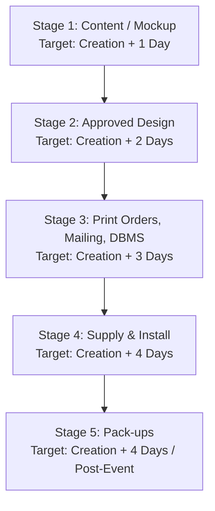

# Branding & Production Workflow Specification

# Project: FMS — Faculty Management System

# Department: Geeta University — Branding Department

## 1. Workflow Overview

The Branding & Production workflow manages physical, environmental, and print logistics for university campus branding, physical backdrops, directional signage, event stage fabrication, and collateral distribution.

---

## 2. Job Master Attributes

- **Job / Event Name**: Official title of the institutional initiative.
- **Date of Event**: Targeted execution date.
- **Venue**: Physical location (e.g., Main Auditorium, North Campus Lawns, Sports Arena).
- **Organiser**: Sponsoring faculty, administrative unit, or student council.
- **Created Timestamp**: Auto-recorded timestamp of job registration.
- **Job Owner**: Assigned production supervisor.

---

## 3. The 5 Sequential Production Stages

The departmental master sheet outlines a strict 5-stage sequential progression:

### Stage 1: Content / Mockup

- **Responsible Person**: Dynamic assignment (e.g., Graphic Specialist).
- **Proposed Target**: 1 day post job creation (_subject to working/calendar days confirmation_).
- **Deliverable**: Google Drive link containing visual concept mockups.

### Stage 2: Approved Design

- **Responsible Person**: Job Owner / Art Director.
- **Proposed Target**: 2 days post job creation.
- **Deliverable**: Final print-ready vectors and approved sign-off sheet.
- **Statuses**: `NOT_DONE`, `IN_PROCESS`, `APPROVED`.

### Stage 3: Print Orders, Mailing Design, DBMS

- **Responsible Person**: Production Logistics Coordinator.
- **Proposed Target**: 3 days post job creation.
- **Deliverable**: Vendor purchase orders, direct mail dispatches, and DBMS print queue entries.
- **Statuses**: `NOT_DONE`, `IN_PROCESS`, `DONE`.

### Stage 4: Supply & Install

- **Responsible Person**: On-site Installation Lead.
- **Proposed Target**: 4 days post job creation.
- **Deliverable**: On-site photo verification of banners, backdrops, and physical branding installed at venue.
- **Statuses**: `NOT_DONE`, `IN_PROCESS`, `DONE`.

### Stage 5: Pack-ups & Teardown

- **Responsible Person**: Inventory and Logistics Lead.
- **Proposed Target**: Immediate post-event completion.
- **Deliverable**: Teardown verification, reusable asset return, and post-event credit allocation.
- **Statuses**: `NOT_DONE`, `IN_PROCESS`, `DONE`.
- **Credit Allocation**: Credits recorded in `credit_ledger_entries`.
