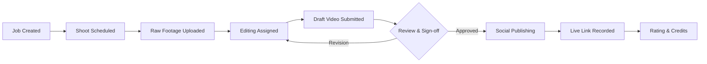

# Content Creation Workflow Specification

# Project: FMS — Faculty Management System

# Department: Geeta University — Branding Department

## 1. Workflow Overview

The Content Creation workflow manages the dynamic media pipeline for university social channels, marketing campaigns, student engagement, and campus event documentation.

---

## 2. Job Metadata & Categories

### Job Master Attributes

- **Job Date**: Date of campaign initiation or occurrence.
- **Job Type**: Fixed to `CONTENT_CREATION`.
- **Job / Activity Name**: Canonical title (e.g., "Annual Convocation Reel Coverage").
- **Owner / Team Lead**: Assignee responsible for overseeing the creative execution.

### Standard Categories (from Source Master)

1. Events
2. Placement Highlights
3. Meta Advertisements
4. Campus Life & Culture
5. Hostel & Sports Activities
6. Academic Department Spotlights
7. Pre-Event Promotional Drives
8. Guest / Industry Expert Bytes
9. Personal Branding
10. Personal Branding of PC (Pro Chancellor / Leadership)
11. International Student Showcases

---

## 3. Deliverable Types

1. **Photo Post**: High-resolution curated still image or carousel.
2. **Byte Reel**: 15–30 second snappy short-form video.
3. **Standard Reel**: 30–60 second narrative or visual reel.
4. **Chronological Video**: Full event documentation / chronological recap.
5. **Live Story**: Real-time coverage broadcast during live happenings.
6. **Photography Class**: Specialized curriculum / educational photography asset.
7. **Pre-Event Promotional Reel**: Teaser asset driving event registration.
8. **Scripted Cinematic Reel/Video**: Multi-take, story-boarded cinematic production.

---

## 4. Sequential Production Pipeline

### Stage 1: Shoot & Cameraman Execution

- **Assigned Person**: Designated cameraman/videographer.
- **Scheduled Shoot Date vs. Actual Shoot Date**: Monitored for punctuality.
- **Deliverable**: Raw footage repository link (`rawFootageUrl` via Google Drive or direct storage).
- **Status Options**: `NOT_INITIATED`, `IN_PROGRESS`, `COMPLETED_ON_TIME`, `LATE_COMPLETED`, `CANCELLED`.

### Stage 2: Video Editing

- **Assigned Person**: Designated video editor.
- **Scheduled Edit Date vs. Actual Edit Date**: Tracks turnaround speed.
- **Submission**: Draft video link (`approvedVideoUrl` or versioned file upload) and change notes.

### Stage 3: Quality Review & Approval

- **Reviewer**: Assigned Deputy Manager or Main Manager.
- **Verdicts**: `APPROVED`, `REVISION_REQUESTED`, `REJECTED`.
- **Rating**: 1–5 stars awarded upon approval.

### Stage 4: Social Media Publishing

- **Responsible**: Social media publishing coordinator.
- **Deliverable**: Actual publish date and permanent public URL (`livePostUrl`).
