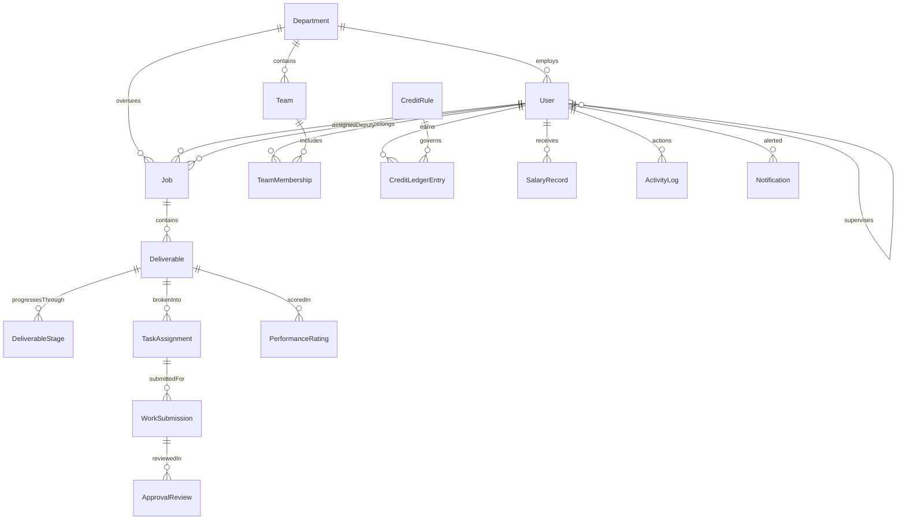

# Database Design & Entity-Relationship Model

# Project: FMS — Faculty Management System

# Database: MariaDB / MySQL via Prisma ORM 6.19.3

## 1. Architectural Principles

- **Explicit Relations**: Every foreign key is mapped to an index to ensure fast join resolution.
- **Relational Integrity**: Deletion of parents (e.g., Department or Job) cascades to subordinate deliverables while preserving audit logs via `SetNull`.
- **Append-Only Auditing**: State transitions and approvals are logged in immutable ledger tables (`activity_logs`, `credit_ledger_entries`).
- **Segregated Confidential Data**: Sensitive compensation information (`salary_records`) is decoupled from general user directory queries.

---

## 2. Entity Model Overview

---

## 3. Table Catalog

| Table                      | Name                    | Primary Responsibility                                                                                 |
| :------------------------- | :---------------------- | :----------------------------------------------------------------------------------------------------- |
| `departments`              | `Department`            | Top-level academic/administrative organizational unit.                                                 |
| `users`                    | `User`                  | Department staff, roles, credentials, and recursive reporting hierarchy (`managerId`).                 |
| `teams`                    | `Team`                  | Operational production units (e.g., Yashpreet Media Unit, Design Studio).                              |
| `team_memberships`         | `TeamMembership`        | Many-to-many relationship mapping users to teams with specific roles (`LEAD`, `MEMBER`, `SPECIALIST`). |
| `jobs`                     | `Job`                   | Master production projects, campaigns, or campus events.                                               |
| `deliverables`             | `Deliverable`           | Concrete assets (Photo Post, Byte Reel, Mockup, Pack-up).                                              |
| `workflow_templates`       | `WorkflowTemplate`      | Blueprints defining standardized sequential production stages.                                         |
| `workflow_stage_templates` | `WorkflowStageTemplate` | Individual steps within a workflow template with target turnaround days.                               |
| `deliverable_stages`       | `DeliverableStage`      | Active workflow stages instantiated for a specific deliverable.                                        |
| `task_assignments`         | `TaskAssignment`        | Individual work allocations linking deliverable stages to specific employees.                          |
| `work_submissions`         | `WorkSubmission`        | Versioned files and cloud links uploaded by employees.                                                 |
| `approval_reviews`         | `ApprovalReview`        | Management evaluations, public feedback, and private managerial notes.                                 |
| `performance_ratings`      | `PerformanceRating`     | 1 to 5 star scores awarded for completed deliverables.                                                 |
| `credit_rules`             | `CreditRule`            | Configurable point and weighting values for output types.                                              |
| `credit_ledger_entries`    | `CreditLedgerEntry`     | Immutable transaction log of credits awarded to personnel.                                             |
| `salary_records`           | `SalaryRecord`          | Confidential compensation figures for managerial ROI denominators.                                     |
| `activity_logs`            | `ActivityLog`           | Immutable audit trail capturing user IP, actions, and previous/new state diffs.                        |
| `notifications`            | `Notification`          | System notifications for task assignments, approvals, and revision requests.                           |
